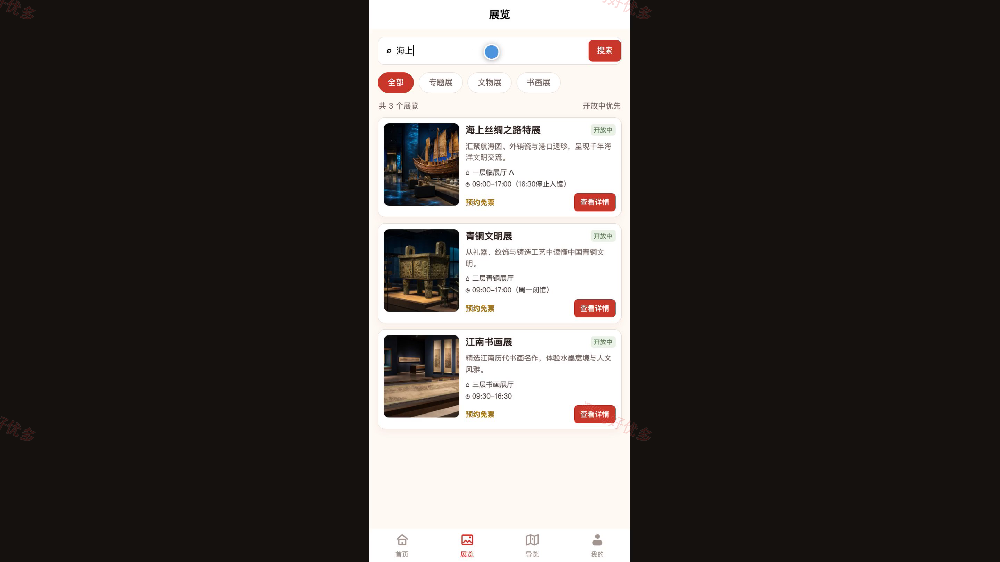
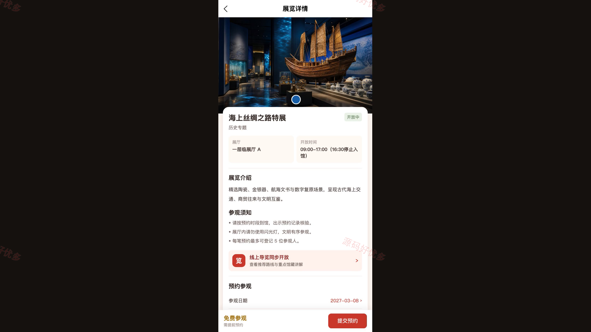
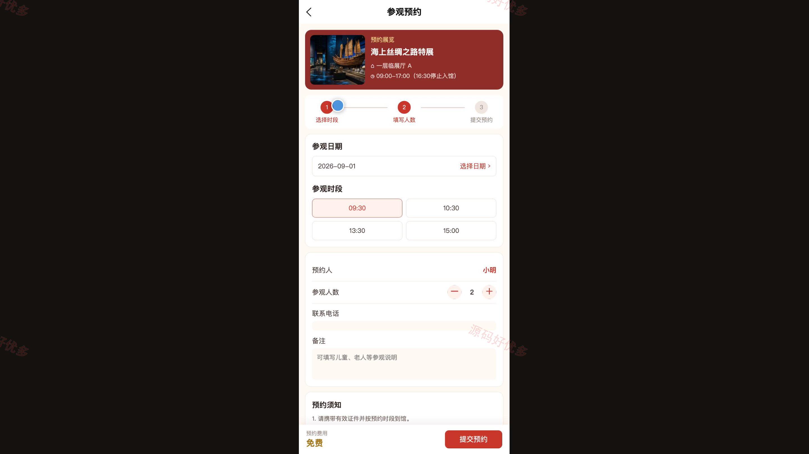
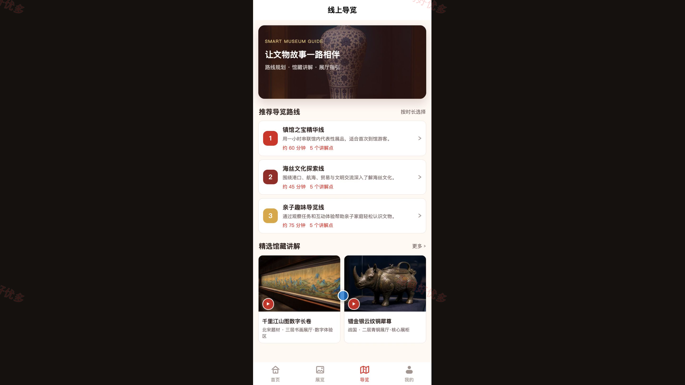
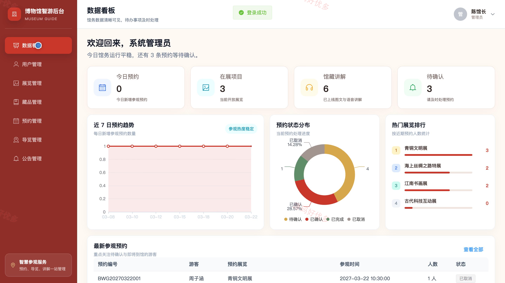
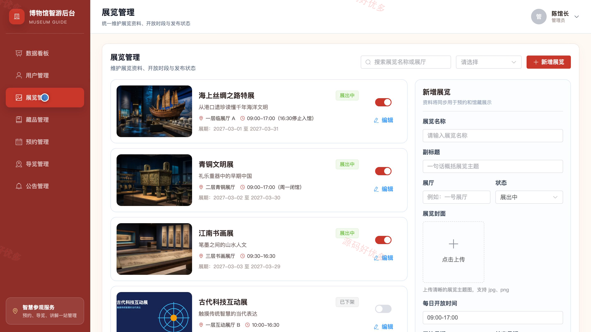
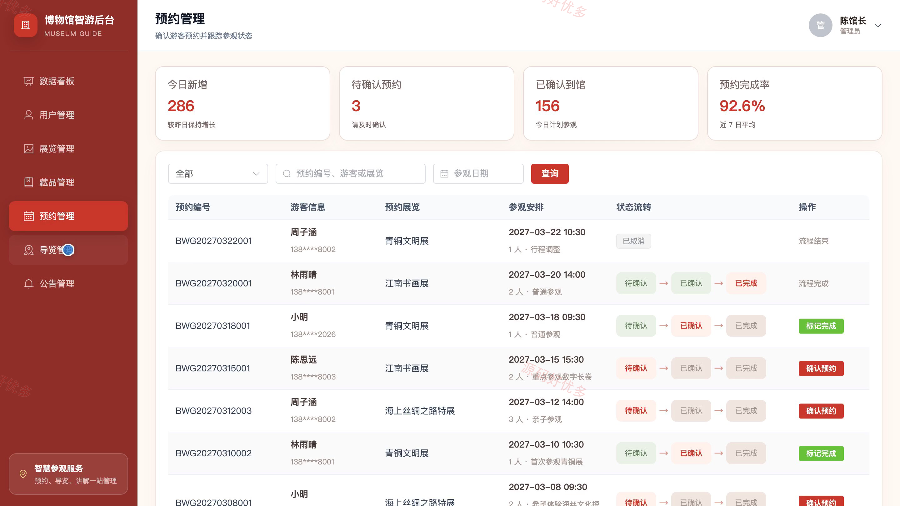

# bs048B
bs048B博物馆展览预约小程序源码 Java SpringBoot3 Vue3 设计文档 PPT
## 源码问题查看主页咨询

### 一、关键词
展览预约、参观预约、线上导览、馆藏讲解、馆内公告

### 二、作品包含
源码+数据库+万字设计文档+PPT+全套环境和工具资源+本地部署教程

### 三、项目技术
前端技术： Html、Css、Js、Vue3.4、Element-Plus、uniapp
后端技术：Java、SpringBoot3.2.7

### 四、运行环境要求
开发工具：IDEA/eclipse + VSCODE + HBuilder X + 微信开发者工具

数据库：MySQL5.7+（共7张表）

数据库管理工具：Navicat10以上版本

环境配置软件： JDK17 + Maven3.6

前端Nodejs：18

浏览器：谷歌浏览器

### 五、项目介绍
项目编号：bs048B

本系统面向博物馆参观服务场景，游客可在微信小程序中浏览展览与馆藏资料、提交参观预约、查看预约状态并使用线上导览；管理员通过网页后台维护游客、展览、藏品、预约记录、导览路线和公告信息，形成从展览发布、游客预约到预约确认与完成的业务闭环。

角色：游客、管理员

游客功能：账号注册登录、展览浏览与筛选、参观预约、预约状态查看与取消、线上导览、馆藏图文与语音讲解、公告浏览、个人资料与密码维护。

管理员功能：管理员登录与个人中心、预约数据看板、游客账号管理、展览与藏品管理、预约确认与完成、导览路线管理、公告发布与维护。

### 六、运行截图

